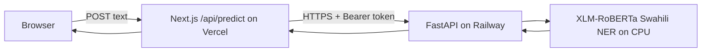

# Architecture and operational notes



## Trust boundaries
- The browser never receives `HF_TOKEN` or `SERVICE_TOKEN`.
- Next.js validates input length (1–2000 characters) and HTTPS upstream URL.
- FastAPI checks a bearer token and validates its own input schema.
- Submitted text is processed in memory; logs contain request length, entity count and duration, **not text**.
- The model is research-grade. Scores are model confidence values, not calibrated probabilities.

## Latency and capacity
- The service runs one Uvicorn worker to avoid duplicating model weights in memory.
- CPU thread count defaults to 2 (`TORCH_THREADS`) to reduce oversubscription.
- Model startup includes a short warmup prediction to remove cold first-request overhead.
- `torch.inference_mode()` disables gradient tracking for inference.
- The Vercel API has a 90-second upstream timeout; this is a safety limit, **not** a performance target.
- Benchmark actual p50/p95 latency with representative Swahili inputs before claiming a speedup.
- Model cold starts, CPU throttling and provider resource limits may dominate latency.

## Evaluation plan
Collect a permitted held-out Swahili NER dataset with matching label scheme, document its license, run entity-level precision/recall/F1 with a fixed model revision and publish the evaluation script, sample count and per-class results. No measured F1 or p95 is claimed for this deployment.

## Security / production gaps
Before wider public use add rate limiting, abuse monitoring, token rotation, dependency pinning, and data retention policy. Keep third-party model and dataset license notices. Do not use this demo for high-stakes decisions.

## Smoke test
```bash
curl -sS https://YOUR_VERCEL_DOMAIN/api/predict \
  -H 'Content-Type: application/json' \
  -d '{"text":"Barack Obama alitembelea Nairobi nchini Kenya."}'
```
Expect `language: sw`, `entities` array, `latencyMs` number. Confirm highlighted spans match their character offsets. A successful response alone does not establish model accuracy.
